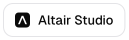
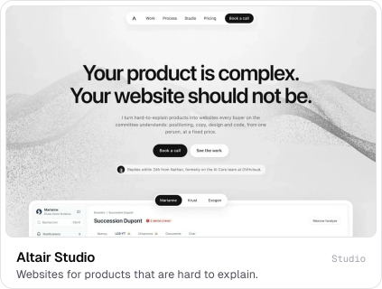
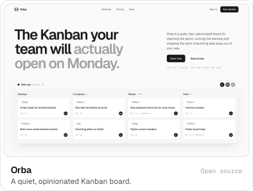
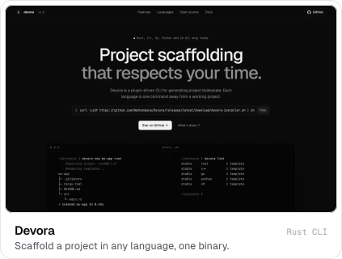

<picture><source media="(prefers-color-scheme: dark)" srcset="assets/hero-dark.svg"></picture>

<a href="https://nathandona.com"><picture><source media="(prefers-color-scheme: dark)" srcset="assets/link-site-dark.svg"></picture></a><a href="https://altair-studio.com"><picture><source media="(prefers-color-scheme: dark)" srcset="assets/link-altair-dark.svg"></picture></a><a href="mailto:nathan@altair-studio.com"><picture><source media="(prefers-color-scheme: dark)" srcset="assets/link-email-dark.svg"></picture></a><a href="https://www.linkedin.com/in/nathan-donadey"><picture><source media="(prefers-color-scheme: dark)" srcset="assets/link-linkedin-dark.svg"></picture></a><a href="https://x.com/NathanDona_"><picture><source media="(prefers-color-scheme: dark)" srcset="assets/link-x-dark.svg"></picture></a>

I'm a product designer and software engineer, and the founder of <a href="https://altair-studio.com"><picture><source media="(prefers-color-scheme: dark)" srcset="assets/altair-dark.svg"></picture></a> [Altair Studio](https://altair-studio.com). I design and build software, and the websites that explain it. I care about products that are quiet, clear and easy to read, from the code to the page that sells it.

I'm currently doing a Master's in AI at Beijing Jiaotong University and running the studio remotely alongside it.

### Selected work

<a href="https://altair-studio.com"><picture><source media="(prefers-color-scheme: dark)" srcset="assets/tile-altair-dark.svg"></picture></a><a href="https://www.exogen.app"><picture><source media="(prefers-color-scheme: dark)" srcset="assets/tile-exogen-dark.svg"></picture></a><a href="https://github.com/Nathandona/Orba"><picture><source media="(prefers-color-scheme: dark)" srcset="assets/tile-orba-dark.svg"></picture></a><a href="https://github.com/Nathandona/Devora"><picture><source media="(prefers-color-scheme: dark)" srcset="assets/tile-devora-dark.svg"></picture></a>

### Experience

- <picture><source media="(prefers-color-scheme: dark)" srcset="assets/altair-dark.svg"></picture> **Founder, Altair Studio** (2023 to now)
- <picture><source media="(prefers-color-scheme: dark)" srcset="assets/co-ovh-dark.svg"></picture> **Software engineer, OVHcloud**, AI Core team (2026)
- <picture><source media="(prefers-color-scheme: dark)" srcset="assets/co-netexcom-dark.svg"></picture> **Full-stack developer, NETexcom** (2025 to 2026)
- <picture><source media="(prefers-color-scheme: dark)" srcset="assets/co-basesud-dark.svg"></picture> **Full-stack developer, BASE SUD** (2022 to 2024)
